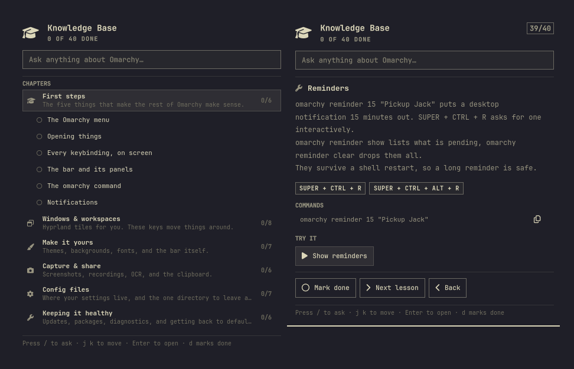

# Omarchy Knowledge Base

A bar panel that teaches you Omarchy and answers questions about it, without
sending you off to a browser tab.



Three things share one panel:

- **A tutorial.** 40 lessons across 6 chapters, each with the keybindings it
  is about, the commands it mentions, and a done marker. Your progress is
  kept in `shell.json`, so it survives a restart.
- **An ask box.** Typing searches a bundled index that ships with the plugin.
  It is instant and works offline. If nothing in the index fits the question,
  the plugin can hand it to the `claude` CLI instead (see
  [Configuration](#configuration)).
- **One-tap actions.** Lessons offer the command they are about as a button:
  toggle night light, move the bar, take a screenshot, grab text off the
  screen. Only reversible, passwordless `omarchy` commands are ever wired to
  a button — see [What it will and will not run](#what-it-will-and-will-not-run).

## Install

```bash
omarchy plugin add https://github.com/rastlyn80/omarchy-knowledge-base --enable
```

The icon lands on the right of the bar. Click it, or bind a key to
`omarchy-shell io.github.rastlyn80.knowledge-base toggle`.

## Using it

| Key | Does |
| --- | --- |
| `/` | Jump to the ask box |
| `j` / `k`, arrows | Move the cursor |
| `Enter` | Open a lesson, or run what the cursor is on |
| `d` | Mark the lesson done or not done |
| `n` / `p` | Next / previous lesson |
| `g` | Back to the chapter list |
| `Tab` | Next panel along the bar |
| `Esc` | Back one level, then close |

The mouse does all of it too. Escape unwinds one step at a time — an answer,
then what you typed, then the lesson — and only closes the panel from the top.

## Configuration

Settings live in this widget's entry in `~/.config/omarchy/shell.json`, or
under the widget in the shell's settings panel.

| Key | Default | Does |
| --- | --- | --- |
| `claudeFallback` | `true` | Whether a question the bundled index cannot answer may be sent to the `claude` CLI |
| `completed` | `[]` | Lesson ids you have marked done. The plugin writes this; you can clear it from the panel |

```json
{ "id": "io.github.rastlyn80.knowledge-base", "claudeFallback": false }
```

## Dependencies

- **`claude`** — optional, and only used by the fallback described below.
  Without it the ask box still works; the index answers on its own. The
  plugin does not install it.
- **`wl-copy`** (wl-clipboard) — for the copy buttons. Already on an Omarchy
  install.

## What leaves your machine

Nothing, until a question falls through the bundled index *and*
`claudeFallback` is on. Then the plugin runs the `claude` CLI that is already
installed on this machine, with your typed question and nothing else — no
file contents, no config, no lesson history. Claude is given the three
read-only tools (`Read`, `Grep`, `Glob`) so it can answer a question about
your own setup; it cannot write anything.

Set `claudeFallback` to `false` and the plugin never shells out at all. The
index still answers most questions, and the "Ask Claude instead" button
disappears.

## What it will and will not run

Every command the plugin can run passes one gate, whether it came from a
lesson or out of a model's answer. It must be an `omarchy` command on an
allowlist of routes that are reversible and never ask for a password:
`theme`, `toggle`, `launch`, `menu`, `capture`, `bar`, `font`, `dock`,
`display text`, `reminder`, `restart`, `plugin list`, `system lock`.

Deliberately not on it: `refresh` and `reinstall` (they overwrite your
config), `update`, `pkg`, `install` and `setup` (long, privileged,
interactive), `dev`, `drive`, `hibernation`, `channel`, and every `system`
action other than `lock`. Those still appear in lessons — you just get the
command to read and copy, not a button.

Commands are executed as an argument vector, never through a shell, so
nothing in a command's arguments can be interpreted as shell syntax. A
command Claude suggests that fails the gate is shown with a copy button and a
note saying why.

## Translations

All of the text — lessons included — lives in `i18n/`, one flat JSON file per
Omarchy language code. Only `en.json` ships today. A translation is one file,
and missing strings fall back to English, so a partial one is useful. Pull
requests welcome.

## Removing it

```bash
omarchy plugin remove io.github.rastlyn80.knowledge-base
```

That takes the widget off the bar and deletes the folder. Your progress goes
with the widget's `shell.json` entry.

## Hacking on it

- `Kb.js` — chapter and lesson structure, the search, and the command gate
- `i18n/en.json` — every string a human reads
- `Panel.qml` — the bar button, the panel, and the keyboard model
- `PlainText.qml`, `LessonRow.qml`, `CommandRow.qml`, `KeyChip.qml` — the
  pieces the panel is built from

QML edits reload the moment you save them. Edits to `Kb.js` do not — a
`.pragma library` script is cached for the life of the shell process, so run
`omarchy restart shell` after changing it.

```bash
omarchy plugin validate .
```

## License

MIT. See [LICENSE](LICENSE).
